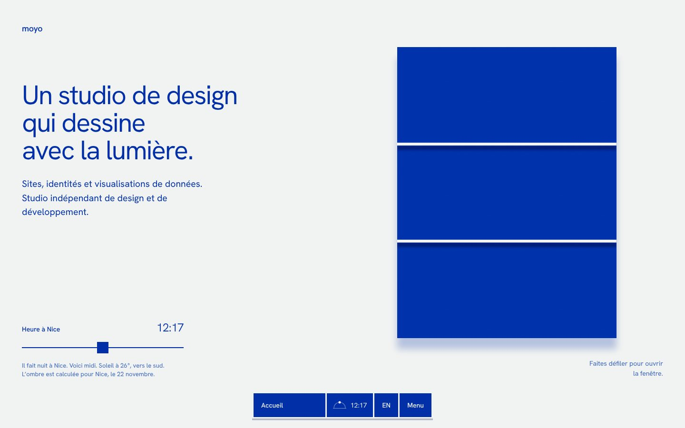
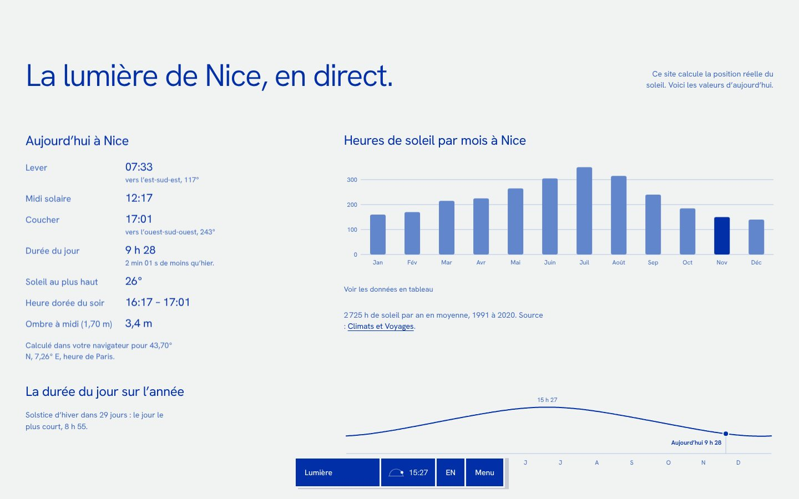
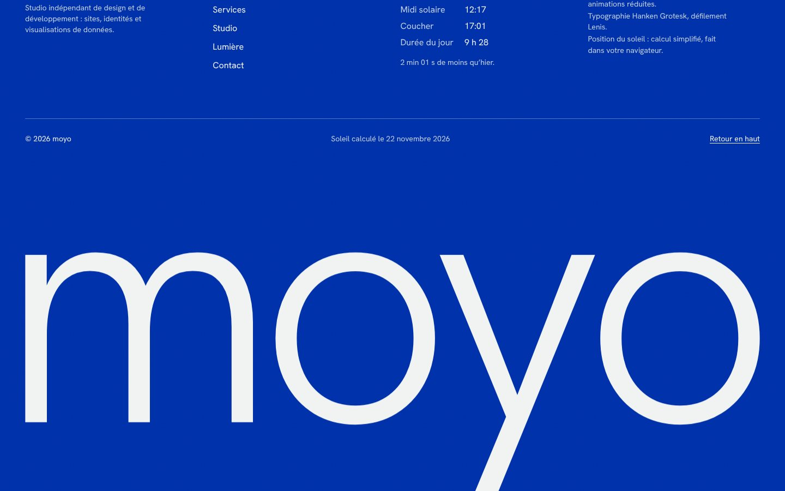

# moyo

Site du studio **moyo** (Zahia Bougouffa, Yacine Bouabdallah) : une seule page, en français et en anglais, sans framework ni dépendance au runtime.

Contact : contact.moyostudio@gmail.com

## Direction artistique

- Deux couleurs : bleu Klein `#002FA7` et blanc de chaux `#F1F3F2`.
- Une famille typographique : Hanken Grotesk (variable), intégrée dans la page.
- Idée centrale : un mur blanc de chaux, une fenêtre bleue qui s'ouvre au scroll, et **le soleil réel de Nice, calculé dans le navigateur**. Il pilote l'ombre de la fenêtre, l'ombre de la barre de navigation, le poids du titre, l'heure affichée et la journée qui défile avec le scroll.
- Aucune ville dans le titre, le contact ni les métadonnées. La section « Lumière » reste calculée pour Nice.
- Mouvement lent : scroll fluide (Lenis), parallax, volets sur les titres, boutons à store.

## Aperçu



| | |
| --- | --- |
|  |  |
|  |  |

Captures prises en bureau 1440 px le 22 novembre 2026 ; les heures du soleil changent chaque jour.

## Contenu de la page

| Section | Contenu |
| --- | --- |
| Hero | La fenêtre qui s'ouvre, le soleil du jour, l'heure réglable |
| Approche | Une phrase, un lien vers les projets |
| Projets | 5 projets d'exemple (plaques abstraites), ouverture en dialogue avec View Transitions |
| Services | Quatre services, la méthode en quatre étapes |
| Studio | Le sens de « moyo », trois principes, l'équipe (noms seulement) |
| Lumière | Lever, midi solaire, coucher, direction du soleil, heure dorée, ombre à midi, écart avec la veille, heures de soleil par mois, durée du jour sur l'année, prochain solstice |
| Contact et pied de page | E-mail, plan du site, lumière du moment, infos sur le site |

Les projets sont des exemples à remplacer (voir `PROJ` dans `src/index.src.html`).

## Technique

- **Une page autonome** : `index.html` (environ 150 Ko) contient le CSS, le JavaScript, la police et Lenis. Pas de cookie, pas de traceur, aucune requête externe.
- **CSS 2026** : `@property`, `animation-timeline: view()`, View Transitions entre document et `<dialog>`, API Popover pour le menu, `linear()` pour les ressorts, `@starting-style`, `text-wrap`, masques CSS.
- **Soleil** : formules d'éphéméride simplifiées (type NOAA), latitude 43,7102, longitude 7,2620, heure de Paris.
- **Accessibilité** : contenu visible sans JavaScript, état « animations réduites » conçu à part, contraste d'au moins 4,5:1, cibles tactiles d'au moins 24 px, navigation au clavier, FR/EN.

## Construire

`src/index.src.html` est le gabarit. Il contient deux marqueurs, `__FONT__` et `__LENIS__`, que `build.py` remplace par la police en base64 et par `vendor/lenis.min.js`.

```bash
python3 build.py        # écrit index.html
```

Ouvrez ensuite `index.html` dans un navigateur, ou publiez le dépôt avec GitHub Pages (branche `main`, dossier racine).

## Tester

Les tests utilisent Playwright (Python) et Google Chrome.

```bash
npm install                  # installe axe-core
pip install playwright
python3 tests/qa.py          # axe-core sur 20 états : bureau 1440 px (FR) et mobile 390 px (EN)
python3 tests/modes.py       # sans JavaScript, animations réduites
python3 tests/rm2.py         # animations réduites : aucune animation active
python3 tests/scroll.py      # scroll Lenis, menu, ancres, dialogue
python3 tests/foot.py 1440 900   # le grand « moyo » est collé au bas de la page
```

Les captures sont écrites dans `tests/out/`. Dernier résultat : 0 violation sur 20 états, aucune erreur console.

## Estimation Awwwards (auto-évaluation, pas un jury)

| Critère | Poids | Note |
| --- | --- | --- |
| Design | 40 % | 7,6 |
| Usabilité | 30 % | 8,0 |
| Créativité | 20 % | 7,3 |
| Contenu | 10 % | 5,5 |
| **Total pondéré** | | **environ 7,4** |

Le point faible est le contenu : projets d'exemple, pas de photos ni de cas clients.

## Reste à faire

- Remplacer les projets d'exemple par de vrais projets (titres, années, textes, images).
- Valider la phrase qui relie le mot « moyo » (cœur, vie, courage) au studio : elle est de ma plume.
- Mesurer la fluidité sur un vrai GPU : l'environnement de test n'en a pas.
- Ajouter d'autres moyens de contact si besoin (réseaux, téléphone).

## Historique

Le dossier `archive/` garde les versions précédentes, les scripts de modification et les anciens tests. Voir `archive/README.md`.

## Crédits et licences

- [Hanken Grotesk](https://fonts.google.com/specimen/Hanken+Grotesk), licence SIL OFL 1.1 : `fonts/LICENSE-hanken-grotesk.txt`.
- [Lenis](https://github.com/darkroomengineering/lenis), licence MIT : `vendor/LICENSE-lenis.txt`.
- Heures de soleil par mois : moyennes 1991 à 2020, [Climats et Voyages](https://www.climatsetvoyages.com/climat/france/nice).
